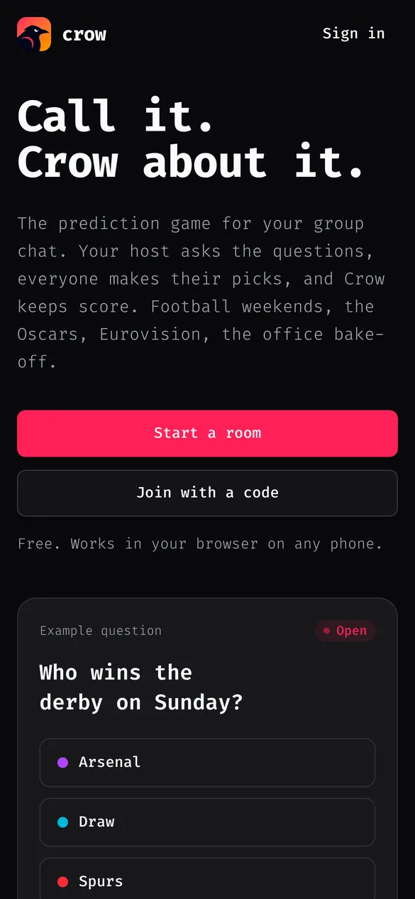
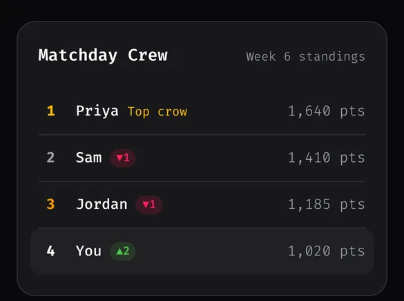
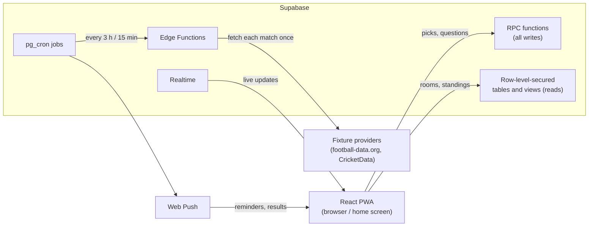

# Crow

**A prediction game for friend groups.** Someone asks a question ("Who wins the derby on Sunday?"), everyone makes a call before the deadline, and Crow keeps score across a season. No money, just bragging rights.

**Live at [playcrow.app](https://playcrow.app)** · built and run by [Kishan Doshi](https://kishandoshi.me)

<p>
  
  &nbsp;
  
</p>

## At a glance

- **In production** with about 15 regular players, running weekly series on Premier League, Champions League, World Cup, IPL and ICC fixtures.
- **Built solo, end to end:** product and UI design, the React app, the Postgres data model and security rules, background jobs, and the server it runs on.
- **No API server.** The browser talks to Postgres directly; the database enforces every game rule.
- **Installable PWA** with push notifications for deadlines, results and weekly standings.

## How it works



The static build is served by nginx on a DigitalOcean droplet. Data, auth and jobs run on Supabase.

## Engineering highlights

**1. The database is the referee.**
Players use the public anon key, so nothing in the browser can be trusted. Every write goes through a `security definer` RPC function that checks membership, deadlines and balances. Reads go through row-level security, so players only ever see the rooms they belong to. The rules are listed in [docs/database-security.md](docs/database-security.md) and tested in CI.

A trimmed excerpt from [`place_bet.sql`](supabase/schemas/predictions/functions/place_bet.sql), the function behind making a pick:

```sql
-- Only open questions, only before the deadline, only for room members.
select * into v_prediction
from public.predictions
where id = p_prediction_id and status = 'draft'
for share;

if v_prediction.deadline <= now() then
  raise exception 'Betting deadline has passed' using errcode = 'P0007';
end if;

-- Lock the wallet so two picks sent at once can't spend the same points.
select * into v_wallet
from public.series_wallets
where series_id = v_prediction.series_id and player_id = v_player.id
for update;
```

**2. One fetch per match, however many rooms follow it.**
Fixtures sync every 3 hours and live results every 15 minutes into a shared `catalog` schema, and every room that follows a competition reads from it. This keeps the app within the providers' rate limits (10 requests a minute on football-data.org) as rooms grow. Each provider sits behind a small adapter, which is how cricket was added next to football without touching the game logic.

**3. Automation instead of an admin.**
`pg_cron` locks questions at their deadline, publishes scheduled questions, settles results, pays the weekly points top-up and posts weekly standings. `pg_net` and an Edge Function turn those events into Web Push notifications.

**4. Installed apps never run a stale build.**
PWAs on home screens kept opening old versions. The fix spans nginx (`no-cache` for HTML and the service worker, one-year immutable caching for hashed assets), a service worker that revalidates, and a build-ID check that reloads silently or offers a refresh. Details are in [docs/deployment-caching.md](docs/deployment-caching.md).

**5. Releases are boring on purpose.**
Pushing a version tag runs a GitHub Actions workflow: it builds, checks the build reports that tag, precompresses assets for nginx, rsyncs them to a new release folder on the server and switches a symlink to it. The last five releases are kept, so a rollback is one command. See [docs/server-setup.md](docs/server-setup.md).

## Quality checks

Every pull request runs:

- TypeScript type-check, ESLint and a production build
- **34 database test files** (`supabase/tests/`), run against a real local Postgres, covering security rules, scoring, payouts, roles, scheduling and notifications
- A drift check that the readable schema files in `supabase/schemas/` match what the migrations produce

## Tech stack

| Area | Tools |
| --- | --- |
| Frontend | React 18, TypeScript, Vite, Tailwind CSS v4, TanStack Query, React Router, Radix UI |
| Data and backend | Supabase: PostgreSQL (RLS, RPC functions, pg_cron, pg_net), Realtime, Auth, Edge Functions (Deno) |
| Delivery | GitHub Actions, nginx, DigitalOcean, Sentry for error reporting |

## Repository tour

```
apps/web/src/
  app/          app shell, routing, providers
  features/     one folder per area (rooms, predictions, leaderboard, fixtures, ...)
  shared/       UI kit, hooks and libraries used across features
supabase/
  schemas/      the database as it is now, one file per table, function or policy set
  migrations/   the ordered changes that build it
  functions/    Edge Functions: fixture sync, push notifications, link previews
  tests/        SQL tests run in CI
deploy/nginx/   production server config
docs/           design notes and how-tos
```

Design and writing guidelines for the app are in [`apps/web/DESIGN.md`](apps/web/DESIGN.md) and [`apps/web/VOICE.md`](apps/web/VOICE.md). Running Crow locally is covered in [docs/development.md](docs/development.md).
